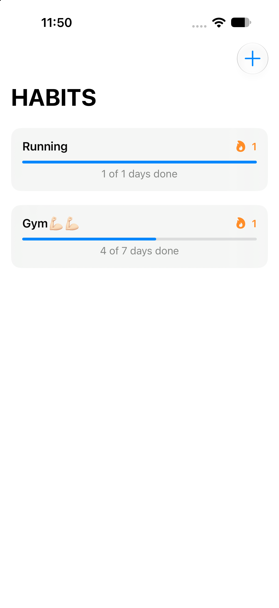
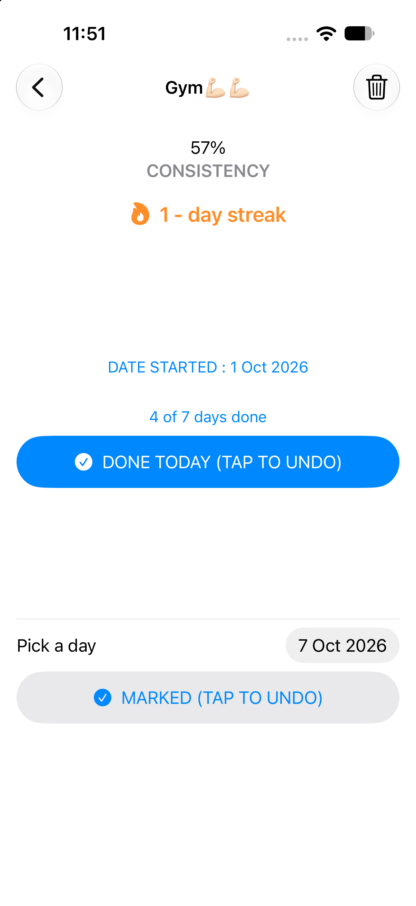
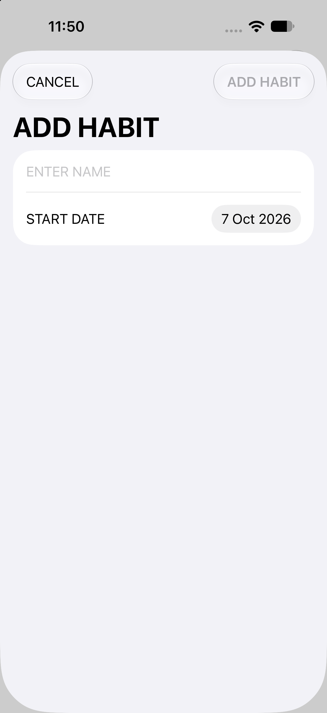

# HabitTracker

A clean, lightweight habit tracking app for iOS, built with SwiftUI. Add the habits you care about, check them off each day, and watch your consistency and streaks grow.


---

## Screenshots

| Home | Habit detail | Add habit |
|:----:|:------------:|:---------:|
|  |  |  |

---

## Features

- **Create habits** with a name and a start date, including dates in the past.
- **One-tap check-off** for today, with an easy undo.
- **Backfill any day** since the start date using the built-in date picker.
- **Consistency score** showing the percentage of days you completed the habit.
- **Streak counter** showing your current run of consecutive days.
- **Progress bar and summary** for every habit on the home screen.
- **Empty state** guiding new users to add their first habit.
- **Safe deletion** with a confirmation dialog.
- **Automatic persistence**, so your data is saved on every change and restored on launch.
- **No accounts, no network, no third-party dependencies.**

---

## Requirements

| Tool    | Version |
|---------|---------|
| Xcode   | 15.0 or later |
| iOS     | 17.0 or later |
| Swift   | 5.9 or later |

The app uses APIs introduced in iOS 17, such as `ContentUnavailableView`, the zero-parameter `onChange(of:)` and `ToolbarItem(placement: .topBarTrailing)`.

---

## Getting Started

1. Clone the repository:
   ```bash
   git clone https://github.com/<your-username>/HabitTracker.git
   cd HabitTracker
   ```
2. Open `HabitTracker.xcodeproj` in Xcode.
3. Select an iPhone simulator (or a connected device).
4. Press **Cmd + R** to build and run.

No package installation or extra configuration is needed.

---

## How It Works

### Data model

Each habit is a `Codable` struct that stores the days it was completed as a set of normalized dates (midnight of each day):

```swift
struct Habit: Identifiable, Codable, Equatable {
    var id = UUID()
    var name: String
    var startDate: Date
    var daysDone: Set<Date> = []
}
```

Normalizing every date with `Calendar.startOfDay(for:)` means a day is counted once, no matter what time you tap the button.

### Metrics

| Metric | Definition |
|--------|------------|
| **Days elapsed** | Number of days from the start date through today, inclusive (minimum 1). |
| **Consistency** | Days completed divided by days elapsed. Today only counts against you once it has passed, so an unfinished today does not lower your score. Capped at 100%. |
| **Streak** | Number of consecutive completed days ending today, or ending yesterday if today is not done yet. A streak is not broken until a full day is missed. |

### Persistence

Habits are encoded to JSON and stored in `UserDefaults` under the key `savedHabits`. Saving is triggered by `onChange(of: habits)`, and loading happens in `ContentView.init()`.

---

## Project Structure

```
HabitTracker/
├── HabitTrackerApp.swift     # App entry point
└── ContentView.swift         # Model and views
    ├── Habit                 # Data model and metric logic
    ├── ContentView           # Home screen, list of habits, persistence
    ├── HabitView             # Detail screen: stats, check-off, date picker, delete
    ├── HabitRow              # Card shown for each habit on the home screen
    └── AddHabitView          # Sheet for creating a new habit
```

---

## Roadmap

Ideas for future versions:

- [ ] Circular progress ring on the detail screen
- [ ] 30-day completion grid in place of the date picker
- [ ] Check-off button directly on each home row
- [ ] Best streak tracking
- [ ] Per-habit colors and SF Symbol icons
- [ ] Swipe-to-delete and reordering
- [ ] Daily reminder notifications
- [ ] Home screen widget
- [ ] Migrate storage from `UserDefaults` to SwiftData
- [ ] Haptic feedback and animations
- [ ] Unit tests for streak and consistency logic

---

## Known Limitations

- Data is stored locally on the device only. Deleting the app deletes your habits, and there is no iCloud sync yet.
- Streak and consistency are calculated using the device's current calendar and time zone, so changing time zones can shift day boundaries.
- All code currently lives in a single file, which is convenient for a small project but should be split into separate files as it grows.

---

## Contributing

Contributions, issues and feature requests are welcome.

1. Fork the repository
2. Create a feature branch: `git checkout -b feature/my-feature`
3. Commit your changes: `git commit -m "Add my feature"`
4. Push the branch: `git push origin feature/my-feature`
5. Open a pull request

---

## Author

**Arnav Singh**

Created October 2026.
